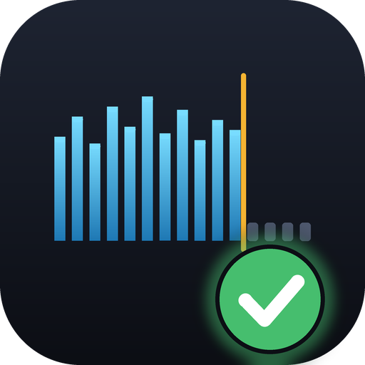

<p align="center"></p>

# TrueLossless

[](https://github.com/0n4sh0/truelossless/actions/workflows/ci.yml)

A small, fast tool that tells you whether your "lossless" and "hi-res" audio
files are the real thing. It scans folders and flags lossy transcodes saved as
FLAC, 44.1/48 kHz audio upsampled to 96/192 kHz, 16-bit audio padded into 24-bit
files, mislabelled containers and damaged FLAC streams.

It ships as a **command-line tool** and a **desktop app**, both built on the
same Rust library. No ffmpeg or other runtime dependency is needed.

## Why

A file named `song.flac` can still be an MP3 that someone re-encoded. Lossy
encoders remove content above a certain frequency, and that gap stays visible
after the file is converted to a lossless format. TrueLossless decodes the audio,
measures where the content really ends, and compares that with what the file
claims to be.

## Features

- Recursive folder scan, plus single files. Drag a folder onto the GUI window.
- Formats: FLAC, ALAC (M4A), WAV, AIFF, MP3, AAC, Ogg Vorbis.
- Content-based detection: the container comes from the file's bytes, not its
  extension.
- Spectrum plot (average of four 5-second excerpts) with the detected band limit.
- Audio quality analysis: peak, true peak, RMS, dynamic range, integrated
  loudness (LUFS), clipping count, bitrate and per-channel stats.
- Spectrogram (time vs. frequency) for the mix and for each channel.
- Audio quality analysis: peak, true peak, RMS, dynamic range, integrated
  loudness (LUFS), clipping count, bitrate and per-channel stats.
- Spectrogram (time vs. frequency) for the mix and for each channel.
- Parallel analysis on all CPU cores.
- Optional FLAC MD5 verification of the decoded audio.
- CSV export from the CLI and the GUI.
- Small binaries, with no installer or runtime.

## What it checks

| Check | Catches |
|---|---|
| Content-based container sniffing | MP3/AAC renamed to `.flac`, a WAV named `.flac` |
| Spectral bandwidth and edge sharpness | Lossy-to-FLAC transcodes (for example a 16 kHz cutoff is typical of MP3 128k) |
| Bandwidth vs. sample rate | 44.1/48 kHz material upsampled to 96/192 kHz |
| Effective bit depth | 16-bit data padded into a 24-bit file |
| FLAC MD5 (`--verify`) | Damaged or edited audio |

### Verdicts

| Verdict | Meaning |
|---|---|
| `GENUINE` | Content matches what the file claims |
| `LOSSY` | An honest lossy file (MP3, AAC, Vorbis) |
| `SUSPECT` | Weak evidence of a problem. Check it by ear or by hand |
| `CORRUPT` | The FLAC MD5 does not match the decoded audio |
| `FAKE` | Strong evidence of a transcode, upsample or padded bit depth |

These are heuristics. A real recording can have a low cutoff, such as old tape
masters, so weak evidence only produces `SUSPECT`. Each verdict lists its
reasons.

## Install

Download the archive for your platform from the
[Releases](https://github.com/0n4sh0/truelossless/releases) page. Each archive
holds both programs.

| Platform | Archive |
|---|---|
| Windows (x64) | `truelossless-<version>-windows-x64.zip` |
| Linux (x64) | `truelossless-<version>-linux-x64.tar.gz` |
| macOS (Apple silicon) | `truelossless-<version>-macos-arm64.tar.gz` |
| macOS (Intel) | `truelossless-<version>-macos-x64.tar.gz` |

Each platform also has a `-portable` archive (Windows and Linux) with the same
programs compressed with [UPX](https://upx.github.io/). It is a smaller download
and starts a little slower. Some antivirus programs flag UPX-packed files, so use
the normal archive if that is a problem for you. macOS has no portable build,
because UPX breaks macOS code signing.

Each platform also has a `-portable` archive (Windows and Linux) with the same
programs compressed with [UPX](https://upx.github.io/). It is a smaller download
and starts a little slower. Some antivirus programs flag UPX-packed files, so use
the normal archive if that is a problem for you. macOS has no portable build,
because UPX breaks macOS code signing.

Verify downloads with `SHA256SUMS.txt` from the same release.

The binaries are not code-signed. On macOS, run
`xattr -d com.apple.quarantine truelossless*` once. On Windows, SmartScreen may
ask for confirmation.

Or build from source (Rust 1.94 or newer):

```
cargo build --release
```

The binaries are in `target/release/`. On Linux, the GUI needs the
`libxkbcommon`, `libwayland` and `libx11` development packages to build, and
OpenGL at run time.

## Usage

### Command line

```
truelossless path/to/music
truelossless path/to/music --verify      # also verify FLAC MD5 (slower)
truelossless path/to/music --probe-only  # headers only (fast, no spectrum)
truelossless path/to/music --all         # show reasons for genuine files too
truelossless path/to/music --quality     # also levels, LUFS, clipping (slower)
truelossless path/to/music --quality     # also levels, LUFS, clipping (slower)
truelossless path/to/music --csv out.csv # write a CSV report
```

Exit codes: `0` normal, `1` no audio files found, `2` at least one file is
fake, corrupt or unreadable. This makes it usable in scripts.

### Desktop app

Run `truelossless-gui`, then pick **Open folder** or drop a folder or file onto
the window. You can also pass a path: `truelossless-gui path/to/music`.

- Left: the file list with a status chip, sample rate and bit depth.
- Right: the verdict with its reasons, key figures, the average spectrum, an
  **Audio quality analysis** card and a **spectrogram** with Mix / per-channel tabs.
  The quality figures are measured when you select a file (a full decode, so
  it takes about a second per song).
- Top bar: filter by status, enable MD5 verification, rescan, **Export CSV**.

### CSV

One row per file, with these columns: `path, status, reasons, container, codec,
lossless, sample_rate_hz, bits_declared, bits_used, channels, duration_secs,
size_bytes, content_ends_khz, edge_db, md5`. Fields that start with `=`, `+`,
`-` or `@` are escaped so spreadsheets do not run them as formulas.

## Project layout

```
assets/ app icon (icon.png, icon.ico), GitHub social preview, make_icon.py
core/  analysis library: probe, decode, spectrum, cutoff, verdict, csv
cli/   truelossless command-line tool
gui/   truelossless-gui desktop app (egui)
```

Generate demo files that trigger every verdict (synthetic noise, for testing
only):

```
cargo run -p truelossless-core --features testgen --example gen_samples -- samples
```

Run the tests with `cargo test --workspace`.

## Releases and CI

- `ci.yml` builds and tests on Linux, Windows and macOS for every push and pull
  request.
- `release.yml` builds release binaries for Windows x64, Linux x64, macOS arm64
  and macOS x64, then publishes them with checksums. To release:

  ```
  git tag v0.1.0
  git push origin v0.1.0
  ```

## Contributing and security

- Pull requests must pass `fmt`, `clippy` and the tests on Linux, Windows and macOS.
- Report vulnerabilities privately, see [SECURITY.md](SECURITY.md).
- The repository rules are in `.github/rulesets/` (import them under
  Settings, Rules, Rulesets).
- Licensed under the [MIT License](LICENSE).

## Known limits

- Thresholds are tuned on synthetic signals only. Real-world tuning is pending.
- ALAC decoding is unverified against real files, because no encoder was
  available for the tests.
- Dynamic range is peak minus RMS (crest factor), not the DR-meter (TT DR) value.
  Loudness is BS.1770 integrated LUFS with equal weight on every channel.
- Mono-as-stereo detection is not implemented.
- No Linux or Windows ARM builds yet.
